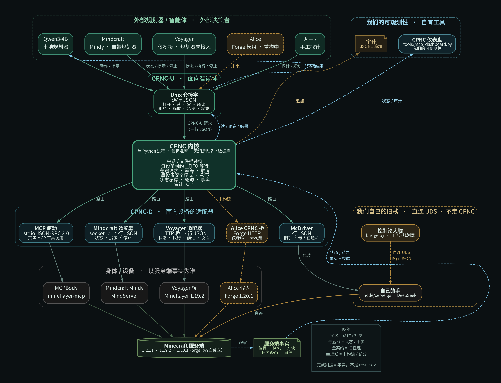
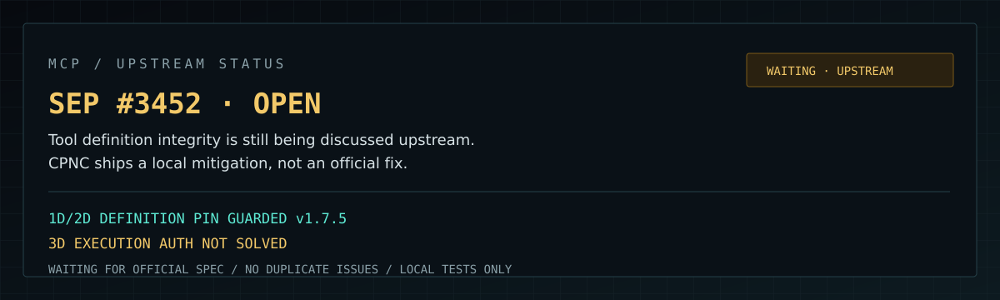
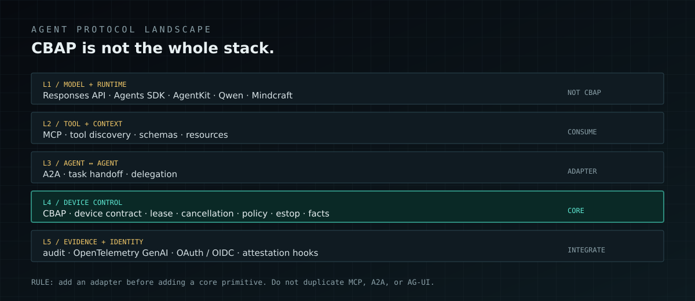

<div align="center">

# Cyberdyne Bridge

### 赛博戴恩之桥 · CBAP v1

> **UNOFFICIAL OPEN-SOURCE PROTOCOL**
> Not affiliated with or endorsed by Mojang, Microsoft, NetEase, DeepSeek,
> Qwen, Mindcraft, Voyager, mineflayer-mcp, or PrismarineJS.

**把异构 Minecraft Agent，变成同一个协议下的外设。**

[](spec/README.md)
[](https://github.com/cyberdyne-bridge/cyberdyne-bridge-agent-physical-protocol/releases)
[](tools/cbap_conformance.py)
[](kernel/)
[](spec/README.md)
[](#)
[](LICENSE)

[架构图](#架构) · [安全边界](#安全边界) · [快速开始](#快速开始) · [发行版](RELEASES.md) · [Wiki](https://github.com/cyberdyne-bridge/cyberdyne-bridge-agent-physical-protocol/wiki) · [四个子仓](#四个-agent-子仓) · [文档](#文档)

</div>

> **Minecraft Agent 不缺能挖矿的脚本。**
>
> 缺的是一个**能换身体、能验收、能急停**的协议。

Cyberdyne Bridge 是 **CBAP v1** 的参考实现：Agent 申请设备、执行动作，最后用**服务端事实**验收，而不是相信一句 `result.ok`。

Minecraft 只是沙盒。真正想验证的是：

```text
信息不完整、动作有代价、环境会变的世界里，
Agent 到底需要什么样的接口与判据。
```

---

## 仓库简介

**主仓是协议，不是某个具体 Bot。**

```text
Agent
  │  CBAP-U：Unix socket / 一行一条 JSON
  ▼
CBAP Kernel
  │  租约 · FIFO · 安全 · 急停 · 取消 · 审计
  │  CBAP-D：每个 Agent 自己的 adapter
  ▼
MCP / Mindcraft / Voyager / Cyberdyne
  │
  ▼
Minecraft 服务端（事实源）
```

一句话：

> **Agent 可以换，身体可以换，验收判据不能换。**

这也是为什么主仓只保留 CBAP、Kernel、租约、安全、审计和 conformance；具体 Agent 放进独立子仓，不写死进内核。

## 10 分钟跑通

```bash
# 干净 clone 后，不需要 Minecraft / Node / LLM / root
python3 tools/cbap_conformance.py --target fake
./tools/quickstart_host_demo.sh
```

实测：

```text
clone 7s + conformance 118s + host demo <2s
```

完整步骤与验收标准见 [`docs/START-10MIN.md`](docs/START-10MIN.md)。

## MC Body（新）

MC 计划已切到：

```text
自研 Mineflayer Body + 外部 Agent Brain + CBAP 控制面
```

已落地：

```text
body/README.md
body/fake_body.py          协议兼容 fake body
docs/MC-BODY-ADR.md        决策记录
docs/MC-BODY-API.md        Body API v0
sdk/python/mc_body_client.py
tests/body/                SDK 测试
docs/MCP-SEP-3452-TESTS.md MCP 授权范围 / instructions digest 测试
docs/MCP-OFFICIAL-MATRIX.md    7 台官方 reference × 5 次矩阵
docs/MCP-3D-TESTS.md           MCP 执行授权 / 定义 pin 修复测试
docs/MCP-UPSTREAM-STATUS.md    MCP 上游状态 / 等待官方修复
docs/VOYAGER-STATUS.md         Voyager bridge 评估
docs/VOYAGER-1.21.1.md         Voyager 1.21.1 bridge 实测
docs/VOYAGER-LOCAL-QWEN.md     Voyager prompt + 本地 Qwen 实测
docs/VOYAGER-AUTONOMY.md       Voyager-style 3/3 自治循环
docs/VOYAGER-UPSTREAM-BENCH.md 上游 Voyager agents + CBAP 2/2
docs/VOYAGER-BUGS.md           Voyager 最小复现与 PoC
poc/mcp_scope_fork_poc.py      MCP same-scope fork / instructions PoC
tools/mcp_official_matrix.py   官方 server 矩阵 runner
```

```bash
python3 -m unittest -q tests.body.test_mc_body_sdk
```

真实 Mineflayer hand 还需要 Node 20+ 和本地 1.21.1 服务器。

MCP #3452 的认证 HTTP / scope 测试：

```bash
python3 -m unittest -v tests.mcp.test_jcs tests.mcp.test_http_scope_integrity
python3 poc/mcp_scope_fork_poc.py

# 7 台官方 reference × 5 次（需要本地 Node/Python 依赖）
python3 tools/mcp_official_matrix.py --repeat 5
```

## 30 秒读懂定位

> Agent 可以换，身体可以换，验收判据不能换。

四个 Agent 子仓各自有独立 smoke：

```bash
for d in agents/cyberdyne agents/mcp-mineflayer agents/mindcraft agents/voyager; do
  python3 "$d/smoke.py" || exit 1
done
```

## 它解决什么

| 常见做法 | 问题 | CBAP 的做法 |
|---|---|---|
| 让 LLM 直接调 Minecraft API | 幻觉、越权、失败后不知道停 | Agent 只能通过协议申请设备、提交动作 |
| 命令返回 200 就算完成 | 「发出去了」不等于「真做到了」 | 用位置、背包、方块、任务终态验收 |
| 多个 Agent 抢同一个 Bot | 操作互相踩、状态互相污染 | 每设备租约 + FIFO 等待 + 每设备急停 |
| 每接一个 Agent 就改主链 | 内核越来越胖，最后不可维护 | Agent 只实现 adapter，主仓只依赖 driver 接口 |
| 出问题只能翻聊天记录 | 没有审计、无法复盘 | JSONL 审计 + 明确的错误码 / 取消语义 |

## 架构



图例：

```text
实线     = 动作 / 控制
青虚线   = 状态 / 事实 / 结果
金实线   = 自己的旧直连
金虚线   = 未构建 / 部分
```

完整说明见 [`docs/REPO_LAYOUT.md`](docs/REPO_LAYOUT.md) 和 [`spec/README.md`](spec/README.md)。

## 协议桥保证什么

| 保证 | 含义 |
|---|---|
| **每设备租约** | 同一设备同一时刻只有一个 writer；等待 FIFO，不靠抢 |
| **显式释放** | `release` / `estop` / `cancel` 是不同语义，不能混用 |
| **服务端事实** | 完成判据来自服务端位置、背包、方块、任务终态 |
| **fail-closed** | 拿不准就拒绝，并且留下原因，不静默吞掉 |
| **幂等与在途** | 断线重连不乱重放；危险状态可以急停 |
| **审计** | 每次动作有账可查，失败也有证据 |
| **Agent 隔离** | 具体 Agent 不进入 Kernel，adapter 可替换 |

## 安全边界

CBAP 不假设 Agent 可信，也不假设“命令发出去了”等于完成。安全是分层控制，不是一句“已加密”。

| 层 | 已实现 |
|---|---|
| **身份 / 文件** | Unix socket `0600` + `SO_PEERCRED`；token 文件 `0600`、`O_NOFOLLOW`；全局 token 与独立 operator token 分离；policy 可按 agent 限制 `uids`、`token_sha256` |
| **权限** | per-device allowlist；`read/write/lease/estop/admin` 能力；普通 Agent 默认没有 estop/admin；operator token 才能 estop、释放租约、审批、resume、reload registry |
| **并发 / 租约** | 每设备单 writer；FIFO waiter；lease TTL；fencing token；显式 `release`；断线/close/estop 取消 pending |
| **限流 / 资源** | 认证前连接上限、hello 超时；session 上限；inflight 上限；per-session 与 per-uid 写速率；单帧上限 |
| **审计** | JSONL hash chain + `seq`；checkpoint 检测尾部截断；可选 HMAC；本地 mirror；远程 NDJSON sink；`CBAP_AUDIT_REQUIRE_ACK=1` 时要求远程 seq/hash ack；审计写失败 fail closed |
| **Watchdog / 安全态** | Kernel 周期性检查驱动状态；超时自动调用 driver estop；estop 锁存；resume 必须 operator + reason + `confirm=RESUME`，且 lease/pending/approval 清空、health 正常 |
| **MCP 设备** | env allowlist（默认不继承完整环境）；rlimits；进程组终止；stdout/stderr 输出上限；manifest HMAC 签名工具（可强制）；tool/instruction pin（首次 TOFU，之后强制）；estop 必须有 safe-state 证据；可选独立 UID/GID 与 bwrap/nsjail |
| **事实校验** | `facts.source="command"` 可接独立进程；`facts.independent`；Kernel 可开 `require_independent_facts`；MCP tool 回执不能代替事实 |
| **Console** | 默认只绑定 `127.0.0.1`；operator token 登录；HttpOnly SameSite cookie；Host/Origin 校验；CSP；登录限速；页面不嵌 token；远程 bind 必须 TLS，可选 mTLS，证书 CN 作为 operator 身份 |
| **操作审批** | 默认不拦普通动作；只有 policy 显式配置 `approvals.ops` 才拦截；可选 `required_approvals=2` 双人审批；SLA 通知 / 可选 webhook；lease 可被 operator 释放 |
| **供应链 / 回归** | 129 条可执行测试；实现矩阵区分 implemented / optional / planned；安全测试覆盖 token、symlink、audit 截断、fencing、MCP pin、mTLS、resume |

### 正常自主运行不需要一步步点击

默认 policy 不启用 approvals：

```text
read / write / lease 正常执行
Console 可以关闭
Agent 仍可 headless 运行
```

审批只用于显式配置的高风险动作；estop 不需要审批，resume 是故障后的人工恢复。

### 仍然不能承诺什么

```text
同一 OS uid / root 仍可读 token、ptrace、改内存
恶意 MCP server 仍可能伪造自己的 facts；独立事实源也不能证明物理世界
bwrap/nsjail、独立 UID、manifest 签名强制都是部署配置，不是默认全开
Console mTLS 终止在 Console；Kernel 本地 UDS 不是端到端远程 mTLS
SLA webhook 是 best-effort；通知 feed 仍是内存
resume 是单 operator 流程，没有双人 resume
没有认证的物理急停、TPM/HSM 或形式化验证
```

完整控制项和残余风险见 [`docs/SECURITY-HARDENING.md`](docs/SECURITY-HARDENING.md)、[`docs/M1-Trust-Boundary.md`](docs/M1-Trust-Boundary.md)、[`docs/M2-Protocol-1.1.md`](docs/M2-Protocol-1.1.md)、[`docs/M3-Operator-Productization.md`](docs/M3-Operator-Productization.md)。

## 四个 Agent 子仓

主仓不把 Agent 写死。四个活跃子仓各自拥有 adapter、`device.json` / `mapping.json`、工具和 smoke：

| 子仓 | 归属 | 设备 | 控制面 |
|---|---|---|---|
| [`agents/cyberdyne`](agents/cyberdyne/) | 我们自己的 MC Agent | `mc://bot/DeepSeek` | 旧脑经 `bridge_cbap.py` 走 CBAP；旧直连已冻结 |
| [`agents/mcp-mineflayer`](agents/mcp-mineflayer/) | 外部 | `mcp://mc/MCPBody` | MCP stdio JSON-RPC |
| [`agents/mindcraft`](agents/mindcraft/) | 外部 | `mc://mind/Mindy` | state / prompt / stop |
| [`agents/voyager`](agents/voyager/) | 外部 | `mc://voyager/bot` | state / exec / forward / say / stop |

Alice 未构建，放在 [`archive/alice`](archive/alice/)，不算活跃子仓。

每个子仓的契约：

```text
agent.json
adapter / driver
device.json + mapping.json
upstream patch
smoke test
```

## 快速开始

### 只跑协议，不碰 Minecraft

```bash
python3 tools/cbap_conformance.py --target fake
```

你会看到：

```text
CBAP v1 conformance · target=fake · cases=129
Ran 129 tests

OK
```

### 跑四个子仓的本地 smoke

```bash
for d in agents/cyberdyne agents/mcp-mineflayer agents/mindcraft agents/voyager; do
  python3 "$d/smoke.py" || exit 1
done
```

### 接真实 Minecraft

分别看：

- [`agents/mcp-mineflayer/README.md`](agents/mcp-mineflayer/README.md)
- [`agents/mindcraft/README.md`](agents/mindcraft/README.md)
- [`agents/voyager/README.md`](agents/voyager/README.md)
- [`agents/cyberdyne/README.md`](agents/cyberdyne/README.md)

## 操作员控制台

CBAP 协议本身不带 UI；`console/` 是一个独立的本地 Host：

```bash
python3 console/server.py --socket ./cbap.sock --audit ./logs/cbap-audit.jsonl
```

打开：

```text
http://127.0.0.1:8765/
```

它现在支持：

```text
单设备 / 全局 estop
lease 查看与 operator 释放
高风险 write 审批（可选双人）
MCP onboarding / probe / 签名 / registry enable-disable
registry_reload 热插拔
resume（operator + reason + confirm=RESUME）
持久化历史图
SLA 通知 / 可选 webhook
```

默认只绑 `127.0.0.1`，校验 Host / Origin；登录使用独立 operator token，页面里不嵌 token。
远程 bind 必须 TLS，可选 mTLS。Kernel 的 estop 仍然锁存，resume 必须显式确认。


详细说明见 [`console/README.md`](console/README.md)。

## 仓库结构

```text
kernel/       CBAP Kernel：会话 / 租约 / 安全 / 急停 / 审计
console/      本地操作员控制台：状态 / 租约 / facts / estop / 审计
spec/         CBAP 协议与设备契约
tests/        conformance
tools/        通用工装（conformance / 并发 / 故障 / 恢复）
docs/         协议文档、迁移说明、中文架构图
agents/       四个活跃 Agent 子仓
archive/      Alice 归档
```

## 当前状态

```text
CBAP conformance       129/129
活跃 Agent 子仓        4
Alice                  源码归档，未构建
CBAP OS 0.1            live ISO / 版本选择 / host bridge 实测
Host device surface    5 个 device_id / 输入默认关闭
控制面 p50             0.2–0.3 ms
旧套件                 已归档，不再进主 CI
```

旧套件已移到 `archive/legacy-bridge/跑全部.sh`，不再属于主 CI；旧直连路径已冻结，默认脑入口是 CBAP wrapper。详见 [`docs/REPO_LAYOUT.md`](docs/REPO_LAYOUT.md) 和 [`docs/M4-Legacy-Decision.md`](docs/M4-Legacy-Decision.md)。

## MCP 上游状态

```text
SEP #3452        OPEN
CBAP v1.7.5      local definition pin mitigation
3D authority     not solved
```



我们不等同于官方修复，也不在 #3452 重复开 issue。
完整边界和链接见 [`docs/MCP-UPSTREAM-STATUS.md`](docs/MCP-UPSTREAM-STATUS.md)。

## 协议地图与长期安排

CBAP 不是“通用 Agent 协议”，也不准备复制 OpenAI / MCP / A2A / AG-UI。



```text
L1 模型/运行时    OpenAI Responses / Agents SDK / Qwen / Mindcraft  不碰
L2 工具/上下文    MCP                                               adapter
L3 Agent ↔ Agent  A2A / task handoff                                adapter
L4 设备控制       CBAP                                              core
L5 证据/身份      audit / OTel / OAuth / attestation                integrate
```

路线与边界见 [`docs/AGENT-PROTOCOL-ROADMAP.md`](docs/AGENT-PROTOCOL-ROADMAP.md)。

## 发行版

当前源码发行版：

```text
v1.7.5  MCP Definition Pin Fix 129/129
v1.7.4  10-Minute Path         118/118
v1.7.3  Technical Hardening    118/118
v1.7.2  Detailed Legal Pack    114/114
v1.7.1  Legal & Notices        114/114
v1.7.0  Device Parity P0–P6  114/114
v1.6.0  Host Device Surface   101/101
v1.5.0  CBAP OS & Host Bridge 101/101
v1.4.0  Legacy Boundary       101/101
v1.3.0  Operator Infra        100/100
v1.2.0  Operator Product      98/98
v1.1.0  Protocol 1.1          96/96
v1.0.0  Security Baseline     82/82
```

Release 页面：

- https://github.com/cyberdyne-bridge/cyberdyne-bridge-agent-physical-protocol/releases

v1.7.5 / v1.7.4 / v1.7.3 / v1.7.2 / v1.7.1 / v1.7.0 / v1.6.0 / v1.5.0 / v1.4.0 附带 `CBAP-parameters-zh.pdf`。
版本边界和兼容性见 [`RELEASES.md`](RELEASES.md)。

## 文档

```text
docs/diagrams/cbap-structure-zh.png    中文架构图
docs/REPO_LAYOUT.md                    主仓 / 子仓 / shim / 迁移
spec/README.md                         CBAP 协议
spec/conformance-v1.md                 conformance 契约
docs/CBAP-内核化设计-2026-10-23.md     Kernel 设计
docs/CBAP-同设备竞争与故障注入.md      竞争与故障
docs/CBAP-cancel与MCP恢复.md           cancel / MCP 恢复
drivers/mcp_device/README.md            通用 MCP 设备驱动 / facts 校验
tools/mcp_device_probe.py               单个 MCP 设备的事实探针
docs/MCP-device-audit-2026-10-24.md     MCP 回执 vs 事实审计
docs/MCP-audit-report-2026-10-24.md     独立 MCP 审计报告（PDF 版同目录）
docs/MCP-protocol-security-2026-10-24.md  MCP 协议级安全审计（PDF 版同目录）
console/README.md                      本地操作员控制台 / 人能看见、能停
docs/SECURITY-HARDENING.md             13 项安全加固 / 控制项与残余风险
docs/CBAP-参数手册.md                  协议 / Kernel / 驱动 / Console 全参数
docs/M1-Trust-Boundary.md              M1 信任边界 / 隔离 / 审计锚点 / 恢复策略
docs/M2-Protocol-1.1.md                M2 特性协商 / poll 过滤 / TCP/TLS
docs/M3-Operator-Productization.md     M3 lease / 审批 / MCP onboarding / probe
docs/M4-Legacy-Decision.md             M4 legacy bridge freeze / CBAP wrapper
docs/CBAP-OS-Host-Bridge.md            CBAP OS VM -> host allowlisted CBAP test
docs/DEVICE-PARITY.md                  Device Contract / policy / quotas / trust / portal
docs/START-10MIN.md                    10 分钟跑通 / 实测耗时 / 验收标准
docs/MC-BODY-ADR.md                    MC Body 决策：自研 hand + 外部 brain
docs/MC-BODY-API.md                    MC Body API v0 / NDJSON / cancel / facts
body/                                  Mineflayer hand（骨架 / fake body）
sdk/python/mc_body_client.py            MC Body Python SDK
RELEASES.md                            源码发行版与版本边界
docs/releases/                         各版本 release notes
agents/*/docs/                         各 Agent 自己的接入文档
```

## 旧子链

旧版 Cyberdyne 脑 / 手、车厢、老祖思维、日记和 M1–M7b 里程碑已经从主 README 移到：

- [`agents/cyberdyne/docs/LEGACY.md`](agents/cyberdyne/docs/LEGACY.md)

这是 Cyberdyne MC Agent 的子链档案，不是 CBAP 主链。

## GitHub About（复制用）

> **CBAP v1：Agent ↔ 物理世界的参考协议桥。主仓只放协议、Kernel、租约、安全、审计；Cyberdyne / MCP / Mindcraft / Voyager 是四个 Agent 子仓。Minecraft 只是沙盒。**

可直接复制到 GitHub 仓库 About 的短描述，另见 [`REPO_DESCRIPTION.md`](REPO_DESCRIPTION.md)。

## 许可

原创 CBAP Kernel / 协议 / 驱动 / 测试代码和原创文档采用 **MIT**，见 [`LICENSE`](LICENSE)。

第三方组件、补丁、运行时依赖、外部项目和名称**不因本仓引用而变成 MIT**：

```text
THIRD_PARTY_NOTICES.md        第三方组件 / 补丁 / 运行时依赖清单
third_party/licenses/         上游 license 原文
TRADEMARKS.md                 第三方名称与商标说明
LEGAL/                        使用条款 / AUP / 隐私 / 滥用 / 风险 / 律师清单
```

其中 `agents/mcp-mineflayer/driver/patches/mineflayer-mcp-place.patch`
来自 **GPL-3.0** 的 `mineflayer-mcp`，该补丁按 GPL-3.0 分发，不属于 MIT
核心。CBAP 只通过独立 stdio 进程与它通信。

Minecraft 是 Mojang Studios 的商标。本项目与 Mojang、Microsoft、网易、
DeepSeek、Qwen、Mindcraft、Voyager、mineflayer-mcp 均无官方关联。

## 免责声明

本项目是实验性研究软件，按 **AS IS** 提供，不提供任何明示或暗示担保。
完整条款见：

```text
DISCLAIMER.md
LEGAL/TERMS.md
LEGAL/ACCEPTABLE-USE.md
LEGAL/ABUSE.md
```

摘要：

```text
只在你拥有或获授权的设备 / 账号 / 服务器 / 网络上使用
禁止未授权访问、反作弊规避、公共服务器滥用、骚扰或违法用途
host bridge 是本地测试设施，不是生产远程管理
host 输入默认关闭；不要把 host bridge 暴露公网
LLM 可能出错；lease / policy / audit / estop 不是安全认证
第三方名称与商标见 TRADEMARKS.md
```

## 安全

漏洞报告和负责任披露见 [`SECURITY.md`](SECURITY.md)。

```text
不要公开贴 token / 私钥 / 他人数据 / 可利用细节
优先使用 GitHub Security Advisory 私密报告
```

## 贡献

提交 PR 即表示你同意贡献按本项目 MIT 许可发布，并保留适用的第三方声明。
详见 [`CONTRIBUTING.md`](CONTRIBUTING.md)。
