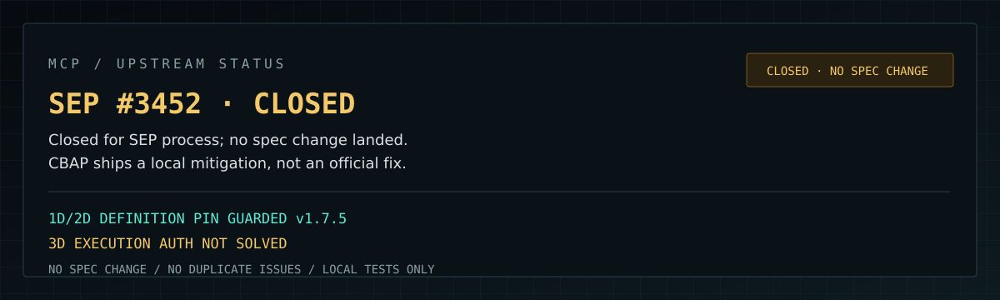

# MCP 上游状态

**日期：** 2026-11-04（复核更新）
**状态：** #3452 已按流程关闭；规范未改，本地缓解继续
**CBAP 本地版本：** v1.7.5
**定位：** 本地缓解，不是官方结论

---

## 一句话

> **MCP #3452 已于 2026-10-26 以流程理由关闭（SEP 需先经 WG/IG），规范正文未改；CBAP 仍只做本地缓解，不把“本地 pin 住了”说成“MCP 修好了”。**



---

## 0. 2026-11-04 复核

```text
2026-10-26 07:06 UTC   #3452 由 @localden 关闭
关闭理由               SEPs require engagement with the relevant WGs/IGs in Discord first
提案状态               无 PR；seps/ 目录无 3452；GitHub 显示 Completed，实际零合并
规范状态               最新仍是 2026-07-28；draft changelog 为空；无 pin / hash / digest 要求
议题去向               Security IG "Runtime drift: list_changed semantics after approval"（Open，无 champion）
社区草案               Client-Held Tool Definition Pinning（Draft，seeking sponsor；未覆盖 instructions）
SDK                    #2410 仍 open（P3 / ready for work），无相关提交
```

结论：

```text
不是“已修复”，是“提案载体关闭、规范未动、议题转 IG”
本地 v1.7.5 仍是唯一执行点；对外的 3D 边界说法不变
```

---

## 0.1 2026-10-26 增量

交接实测带来的更新，不改 CBAP 的边界判断：

```text
MCP 2026-07-28 规范   已发布；去 session / 去 initialize；server/discover
官方 server 包         2.x 为现行线；2026.8.31 四个包已 deprecated
双 era 行为            同一条连接只属于一个 era，首请求决定；#2410 补服务端实测
```

关键后果：

```text
v1.7.5 的 pin 公式是按 legacy initialize / serverInfo 写的
它没有被验证覆盖 2026-07-28 的 _meta.protocolVersion / server/discover 形态
迁移不是改个字符串：scope × protocolVersion × capabilities 都要重新定义
```

所以：

```text
v1.7.5 仍可作为 legacy 本地缓解
不能对外说它覆盖了 2026-07-28
```

---

## 1. 上游现在是什么状态

| 议题 | 状态 | 链接 |
|---|---|---|
| 工具定义完整性 / description pinning | **CLOSED（流程关闭，无规范改动）** | [#3452](https://github.com/modelcontextprotocol/modelcontextprotocol/issues/3452) |
| `instructions` 是否属于完整性范围 | 未决；社区草案也未覆盖 | #3452 thread / Security IG |
| 同授权范围跨 session 一致性 | 规范已有近似条款（SEP-2567），未与 digest 绑定 | `server/tools.mdx` |
| 社区 digest 草案 | **Draft / seeking sponsor，无 PR** | [gist](https://gist.github.com/gautamgb/1e12c07f466389caf5af6715ee367873) |
| Security IG runtime drift | **Open / 无 champion** | [Security IG](https://modelcontextprotocol.io/community/interest-groups/security) |
| serverInfo 可选身份元数据 | **MERGED** | [#3002](https://github.com/modelcontextprotocol/modelcontextprotocol/pull/3002) |
| stateless / sessionless 方向 | **MERGED** | #2567 / #2575 |
| sessions / thread IDs | 工作组讨论 | [transports-wg#36](https://github.com/modelcontextprotocol/transports-wg/issues/36) |
| 2026-07-28 规范 | 已发布；去 session / 去 initialize / `server/discover` | [spec](https://modelcontextprotocol.io/specification/2026-07-28) |
| 官方 server 包 2.x | 现行；`2026.8.31` 系列 deprecated | `server-everything@2.0.1` 等 |
| SDK 双 era 默认 | #2410 仍 open；服务端 legacy-first 也是 sticky | [#2410](https://github.com/modelcontextprotocol/typescript-sdk/issues/2410) |

不要把这些状态混成一句“官方认可”。

---

## 2. 三层边界

```text
1D  Description integrity        文字有没有被换
2D  Tool-definition integrity    schema / annotations / title / instructions
3D  Execution authority          这次调用是否被授权、是否按批准执行
```

#3452 讨论的是 1D/2D（提案已流程关闭，规范未改）。

3D **不在该提案的范围内**。
一个稳定的 digest 不能证明远端 server 会按定义执行。

---

## 3. CBAP 本地做了什么

v1.7.5（**legacy profile，尚未覆盖 2026-07-28**）：

```text
完整 tool object
serverInfo.name + version
instructions（缺失 = 空串）
tools 按 name 排序
RFC 8785 JCS
SHA-256 + domain separator
旧 pin fail closed
每次动作前重新拉取 tools/list 校验
```

测试：

```text
tests/cbap/test_mcp_definition.py
tests/cbap/test_mcp_3d.py
docs/MCP-3D-TESTS.md
```

这些是 **CBAP 的 legacy 本地控制**，不是 MCP 官方实现，也不是 2026-07-28 的完整实现。

---

## 4. 还没有解决的

```text
server 从第一次连接就恶意
server 连 facts 一起撒谎
server 在 tools/list 和 tools/call 之间切换
远端代码/部署替换但没有改定义
approval UI 没有展示完整 args
没有 TPM / 代码 attestation
```

---

## 5. 现在的策略

```text
不在上游重复开 issue
不把本地 pin 说成官方修复
议题走 #security-ig：认领 runtime drift agenda，或支持社区草案
继续保留本地测试和 PoC
等 Security IG / transports-wg 有明确方向
```

如果上游需要，我们可以提供：

```text
JCS profile
限定 scope 的 fixture
同连接 definition drift 测试
3D 边界测试
```

---

## 6. 相关链接

```text
#3452       https://github.com/modelcontextprotocol/modelcontextprotocol/issues/3452
#3002       https://github.com/modelcontextprotocol/modelcontextprotocol/pull/3002
#2410       https://github.com/modelcontextprotocol/typescript-sdk/issues/2410
WG #36      https://github.com/modelcontextprotocol/transports-wg/issues/36
Security IG https://modelcontextprotocol.io/community/interest-groups/security
Draft       https://gist.github.com/gautamgb/1e12c07f466389caf5af6715ee367873
Checkup     docs/MCP-CHECKUP-2026-11-04.md
3D tests    docs/MCP-3D-TESTS.md
Gist        https://gist.github.com/6750432/43837d3355de826dfb83f04acbda9139
```

一句话：

> **上游没修（提案已关、规范未改），CBAP 先把能守的守住；剩下的明确写出来。**
